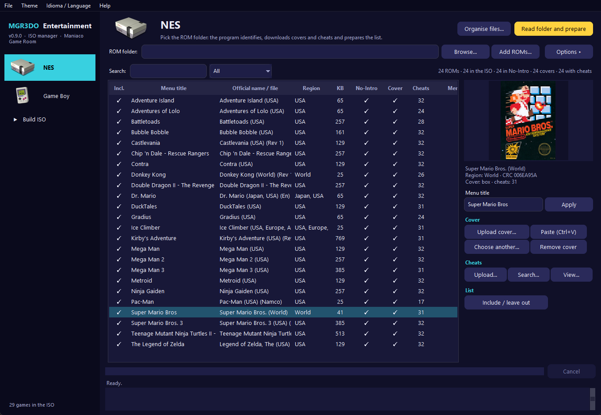
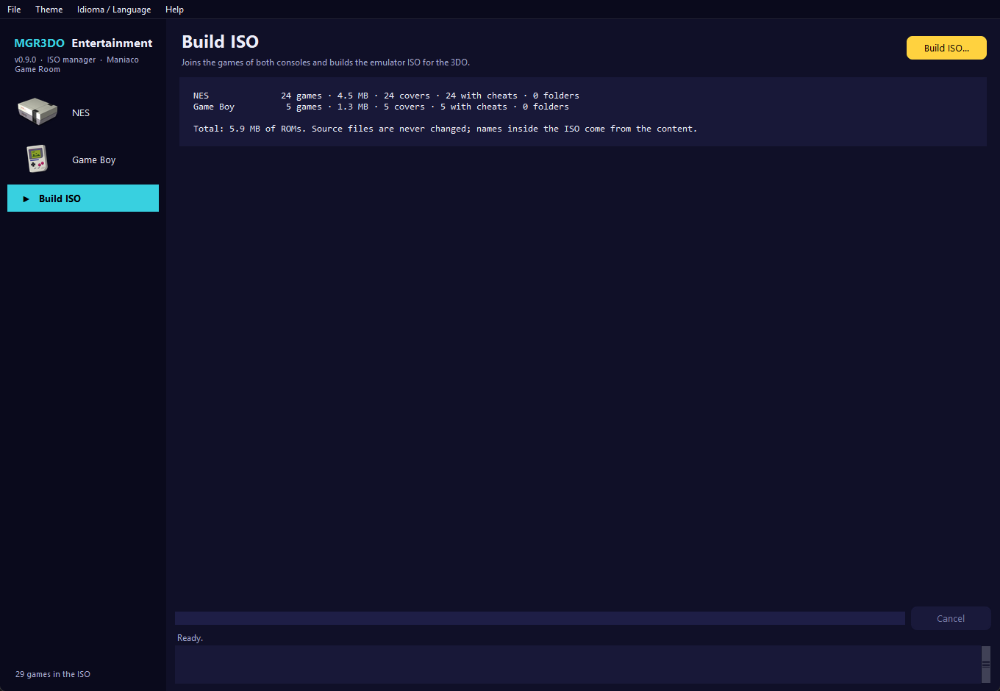
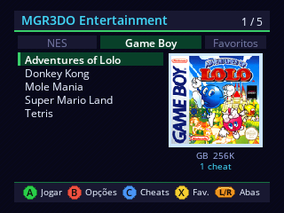

# MGR3DO Entertainment manual

**[Português](MANUAL.md)** · [Back to README](README.en.md)

## 1. Building the ISO on the PC (Manager)

1. Download **`MGR3DO-Entertainment-Gerenciador.exe`** from **[Releases](../../releases)** and keep it in a folder of yours (the update replaces the `.exe` there).
2. On the **NES** page click **Browse…**, pick the ROM folder and click **Read folder and prepare**. The program identifies each ROM, keeps one good copy of each game and downloads cover and cheats.
3. Do the same on the **Game Boy** page.
4. Review the list. For each game you can upload, paste (Ctrl+V) or **choose another** cover; upload, search or view cheats; change the **menu title**; **include or leave out** the game.
5. On **Build ISO**, check the summary and click **Build ISO…**. An existing ISO is never overwritten.
6. **File > Save project** stores everything in a `.mgr3do.json` that points to your ROMs without copying them.

**Options:** one copy per game from the preferred region; ROMs outside No-Intro; bad dumps and prototypes; menu title style; menu folders (automatic, by region, by letter, both or none).

**Organise files…** renames recognised ROMs and optionally sorts them into folders. It shows the plan first, never deletes or overwrites, and has **Undo**.

Program data lives in `%LOCALAPPDATA%\MGR3DO-Entertainment`.

## 2. Taking it to the 3DO

1. Copy the ISO to the ODE pen drive.
2. Leave free space for save states and battery saves. Files go to the `saves` folder if it exists, otherwise to the root.
3. Pick the ISO in the ODE menu. A short opening video plays.

## 3. The game list

| Button | In the list |
|---|---|
| Up / down | choose the game or folder |
| **A** | open the folder or play |
| **B** | go up one folder; at the top, open **Options** |
| **C** | game cheats (Game Boy tab) |
| **X** | toggle **favourite** |
| **L / R** | switch tabs: NES, Game Boy and Favourites |

Favourites are kept in the 3DO memory.

## 4. Playing

| 3DO button | In game (default) |
|---|---|
| D-pad | D-pad |
| **A / B** | console buttons (on Game Boy, configurable in Options > Controls) |
| **P** (Start) | Start |
| **X** | **game menu** |
| **L** | Game Boy: picture size |
| **R** | Game Boy: cycle colours |

On NES, **L** and **R** still open development diagnostic screens.

### Game menu (X)

**Resume · Cheats · Save state · Load state · Restart · Back to the main menu**

- **Save states:** one per game. Writing takes a few seconds; do not power off while the notice is shown. Without the ODE the items are greyed out.
- A Game Boy state includes the cartridge save: loading an old state also brings back the old in-game save.
- Leave games through **Back to the main menu** so the battery save gets written.
- **Cheats:** start switched off. On Game Boy the choice is remembered; on NES it lasts until you leave the game.

## 5. Common problems

- **ROM refused:** unsupported mapper or cartridge chip (see the README list).
- **No cover:** use **Choose another…** or upload an image.
- **Save state greyed out:** it needs the ODE with pen drive access.

---

A **[Maniaco Game Room](https://www.maniacogameroom.com.br/)** project.
