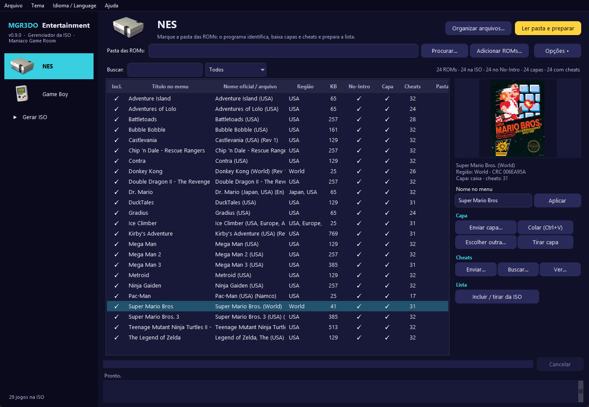
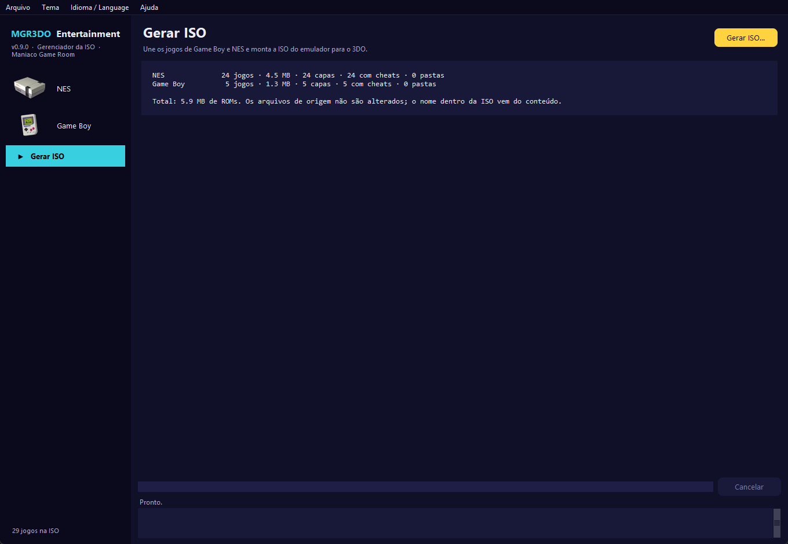
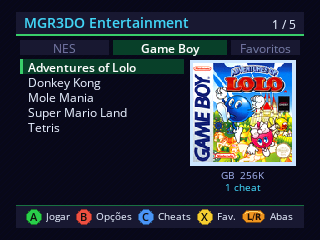

# Manual do MGR3DO Entertainment

**[English](MANUAL.en.md)** · [Voltar ao README](README.md)

## 1. Montar a ISO no PC (Gerenciador)

1. Baixe o **`MGR3DO-Entertainment-Gerenciador.exe`** em **[Releases](../../releases)** e guarde numa pasta sua (a atualização troca o `.exe` nessa pasta).
2. Na página **NES**, clique em **Procurar…**, escolha a pasta das ROMs e clique em **Ler pasta e preparar**. O programa identifica cada ROM, fica com uma boa cópia de cada jogo e baixa capa e cheats.
3. Faça o mesmo na página **Game Boy**.
4. Confira a lista. Em cada jogo dá para enviar, colar (Ctrl+V) ou **escolher outra** capa; enviar, buscar ou ver cheats; mudar o **nome no menu**; **incluir ou tirar da ISO**.
5. Em **Gerar ISO**, confira o resumo e clique em **Gerar ISO…**. Uma ISO existente nunca é sobrescrita.
6. **Arquivo > Salvar projeto** guarda tudo num `.mgr3do.json`, que aponta para as suas ROMs sem copiá-las.

**Opções:** uma cópia por jogo da região preferida; ROMs fora do No-Intro; dumps ruins e protótipos; título do menu (só o nome, com região ou completo); pastas do menu (automático, por região, por letra, as duas ou nenhuma).

**Organizar arquivos…** renomeia as ROMs reconhecidas e, se você quiser, separa em pastas. Mostra o plano antes, não apaga nem sobrescreve e tem **Desfazer**.

Os dados do programa ficam em `%LOCALAPPDATA%\MGR3DO-Entertainment`.

## 2. Levar para o 3DO

1. Copie a ISO para o pen drive da ODE.
2. Para estado salvo e save de bateria, deixe espaço livre. Os arquivos vão para a pasta `saves`, se existir, ou para a raiz.
3. Escolha a ISO no menu da ODE. Há um vídeo curto de abertura.

## 3. A lista de jogos

| Botão | Na lista |
|---|---|
| Cima / baixo | escolhem o jogo ou a pasta |
| **A** | abre a pasta ou joga |
| **B** | volta uma pasta; no topo, abre as **Opções** |
| **C** | cheats do jogo (aba Game Boy) |
| **X** | marca ou desmarca o **favorito** |
| **L / R** | trocam de aba: NES, Game Boy e Favoritos |

Os favoritos ficam na memória do 3DO.

## 4. Jogando

| Botão do 3DO | No jogo (padrão) |
|---|---|
| Direcional | direcional |
| **A / B** | botões do console (no Game Boy, configuráveis em Opções > Controles) |
| **P** (Start) | Start |
| **X** | **menu do jogo** |
| **L** | Game Boy: tamanho da imagem |
| **R** | Game Boy: troca as cores |

No NES, **L** e **R** ainda abrem telas de diagnóstico do desenvolvimento.

### Menu do jogo (X)

**Continuar o jogo · Cheats · Salvar estado · Carregar estado · Reiniciar o jogo · Voltar ao menu inicial**

- **Estado salvo:** um por jogo. A gravação leva alguns segundos; não desligue durante o aviso. Sem a ODE os itens ficam apagados.
- O estado do Game Boy inclui o save do cartucho: carregar um estado antigo traz de volta também o save daquela época.
- Saia dos jogos por **Voltar ao menu inicial**, para o save de bateria ser gravado.
- **Cheats:** começam desligados. No Game Boy a escolha fica guardada; no NES vale até sair do jogo.

## 5. Problemas comuns

- **ROM recusada:** o mapper ou o chip do cartucho não é suportado (veja a lista no README).
- **Sem capa:** use **Escolher outra…** ou envie uma imagem.
- **Estado salvo apagado no menu:** é preciso a ODE com acesso ao pen drive.

---

Um projeto **[Maniaco Game Room](https://www.maniacogameroom.com.br/)**.
