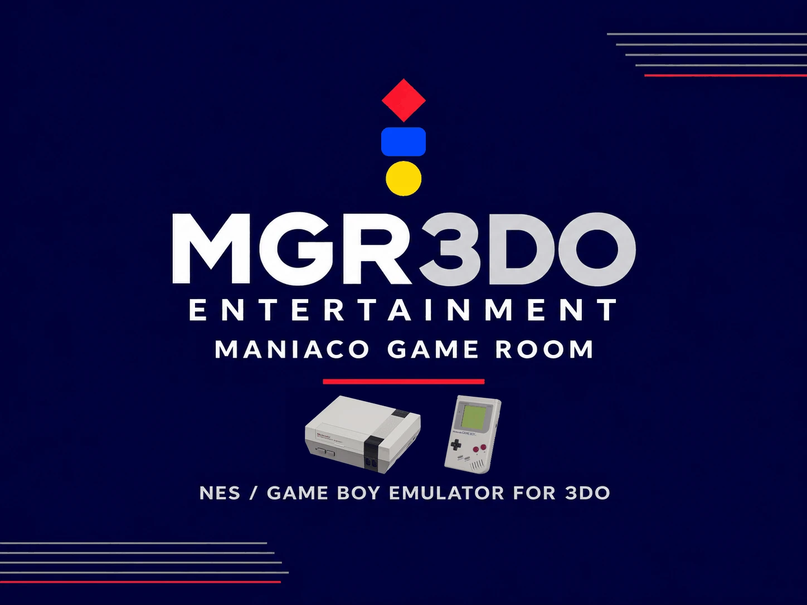
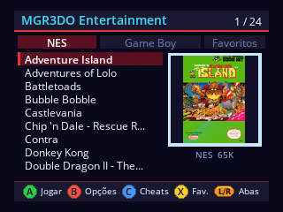
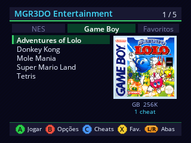
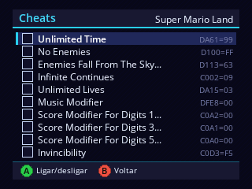
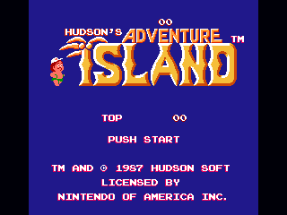
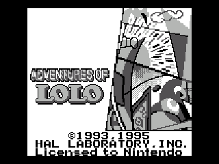
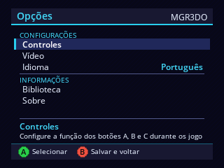
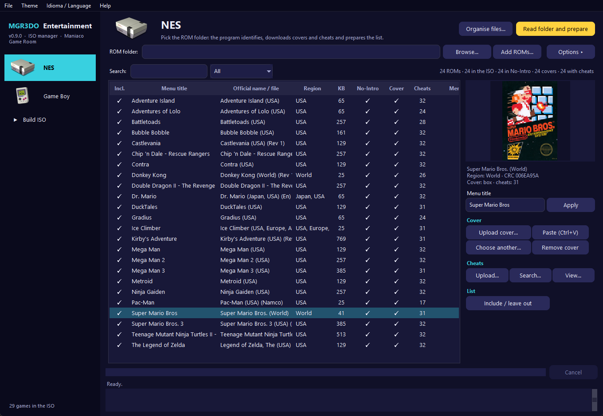

# MGR3DO Entertainment

**[Português](README.md)**

**A NES and Game Boy emulator for the 3DO, with covers, ready-made cheats and save states on the pen drive, plus a Windows app that builds the ISO from your ROMs.**

A **[Maniaco Game Room](https://www.maniacogameroom.com.br/)** project.

> **Version 0.9.0 (beta).** This version is released so the community can help find problems and the project can evolve. Tried it? Tell us what you saw in **[Issues](../../issues)**. See [Help us test](#help-us-test).

## Features

| | |
|---|---|
|  |  |
|  |  |

- **Three tabs:** NES, Game Boy and **Favourites**, with the **cover** on the side and **folders** for large libraries.
- **Ready-made cheats** for most games, switched on and off from the menu.
- **Save states on the pen drive** (one per game), from the in-game menu (X button).
- **Battery saves** for the games that have them, also on the pen drive.
- **Game Boy:** 1.5x or 1x picture and 9 colour sets.
- **NES:** 6502-to-ARM recompiler, full sound including digitised voices.
- Menus in **Portuguese or English**, configurable buttons and a screen size setting for overscanning TVs.

## The app: MGR3DO Entertainment · Manager

The emulator ships compiled inside the app. With your ROMs on the PC it:

1. **identifies each ROM by content** (CRC32 against No-Intro), reads `.zip` too, refuses what the emulator cannot open and keeps one good copy of each game;
2. **downloads cover and cheats** by official name;
3. lets you review: upload or **choose another cover**, upload your `.cht`, edit titles, include or leave out games;
4. **builds the ISO**, ready for the ODE pen drive.

It can also tidy your ROM folder (with **Undo**), works in Portuguese or English and updates itself from Releases. Your ROMs are not modified.

## How to use

1. Download **`MGR3DO-Entertainment-Gerenciador.exe`** from **[Releases](../../releases)** (single file, no install).
2. Pick the **NES** ROM folder and click **Read folder and prepare**. Repeat on the **Game Boy** page.
3. On **Build ISO**, click **Build ISO…**.
4. Copy the ISO to the ODE pen drive, pick it in the ODE menu and play.

Step by step with the controller buttons: **[Manual](MANUAL.en.md)**.

## Requirements

- A **3DO** with an **ODE** that loads ISOs from a pen drive or card (in use: SataTo3DO with the ManiacoODE firmware).
- Windows 10 or 11; internet the first time (covers, cheats and the No-Intro database are cached).
- Your own ROMs (`.nes`, `.gb`, loose or zipped). **No games are included.**

## Compatibility

- **NES:** mappers 0, 1, 2, 3, 4, 7, 11, 66 and 71.
- **Game Boy:** no MBC, MBC1, MBC3 and MBC5 cartridges. Game Boy Color only games do not run.
- Save states and battery saves need the ODE. On a burnt CD or another ODE games should run without them (**not tested**).

**Known limitations:** some games slow down in certain scenes or do not work; the menu's C button (cheats) only works on the Game Boy tab (for NES use X in the game) and NES cheats are not remembered.

## Help us test

Open an [Issue](../../issues) with:

- the **game name** and ROM version (region);
- **what happened** and where (a photo or video helps);
- whether it **happened again** after reopening;
- your **ODE** and 3DO model.

NES, Game Boy and game names are trademarks of their owners. Independent project, not affiliated with Nintendo. No games included.

---

A **[Maniaco Game Room](https://www.maniacogameroom.com.br/)** project.
