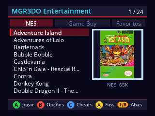
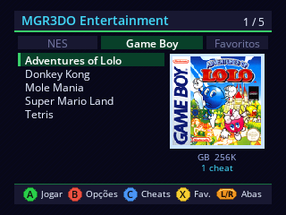
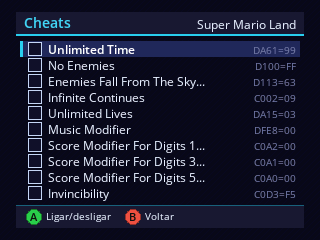
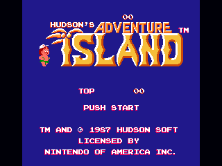
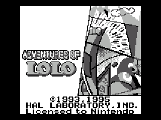
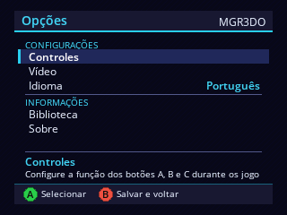
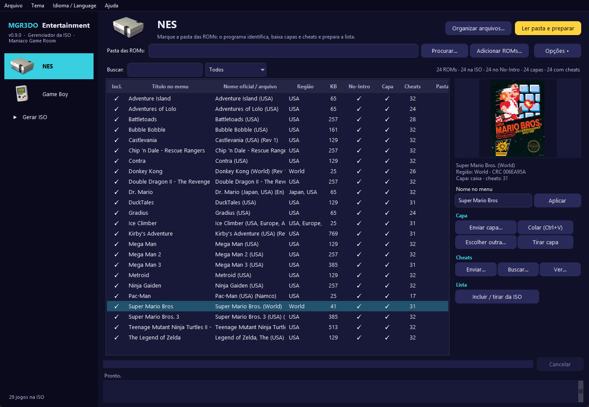

# MGR3DO Entertainment

**[English](README.en.md)**

**Emulador de NES e Game Boy para o 3DO, com menu em português, capas, cheats prontos e estado salvo no pen drive, e um aplicativo para Windows que monta a ISO a partir das suas ROMs.**

Um projeto **[Maniaco Game Room](https://www.maniacogameroom.com.br/)**.

> **Versão 0.9.0 (beta).** Esta versão é divulgada para que a comunidade ajude a identificar situações e o projeto evoluir. Testou? Conte o que viu em **[Issues](../../issues)**. Veja [Ajude a testar](#ajude-a-testar).

## O que traz

| | |
|---|---|
|  |  |
|  |  |

- **Três abas:** NES, Game Boy e **Favoritos**, com a **capa** ao lado e **pastas** para bibliotecas grandes.
- **Cheats prontos** para a maior parte dos jogos, ligados e desligados pelo menu.
- **Estado salvo no pen drive** (um por jogo), pelo menu do jogo (botão X).
- **Save de bateria** dos jogos que têm, também no pen drive.
- **Game Boy:** imagem em 1,5x ou 1x e 9 conjuntos de cores.
- **NES:** recompilador 6502 para ARM, som completo, incluindo vozes digitalizadas.
- Menus em **português ou English**, botões configuráveis e ajuste de tamanho para TVs que cortam a borda.

## O aplicativo: MGR3DO Entertainment · Gerenciador

O emulador já vai compilado dentro do aplicativo. Com as suas ROMs no PC, ele:

1. **identifica cada ROM pelo conteúdo** (CRC32 contra o banco No-Intro), lê também `.zip`, recusa o que o emulador não abre e escolhe uma boa cópia de cada jogo;
2. **baixa a capa e os cheats** pelo nome oficial;
3. deixa você conferir: enviar ou **escolher outra capa**, enviar o seu `.cht`, editar o título, incluir ou tirar jogos;
4. **monta a ISO**, pronta para o pen drive da ODE.

Também organiza a sua pasta de ROMs (com **Desfazer**), funciona em português ou inglês e se atualiza pelas Releases. As suas ROMs não são alteradas.

## Como usar

1. Baixe o **`MGR3DO-Entertainment-Gerenciador.exe`** na página de **[Releases](../../releases)** (um arquivo só, sem instalar).
2. Escolha a pasta das ROMs de **NES** e clique em **Ler pasta e preparar**. Repita na página **Game Boy**.
3. Em **Gerar ISO**, clique em **Gerar ISO…**.
4. Copie a ISO para o pen drive da ODE, escolha-a no menu da ODE e jogue.

Passo a passo com os botões do controle: **[Manual](MANUAL.md)**.

## Requisitos

- **3DO** com uma **ODE** que carregue ISO de pen drive ou cartão (em uso: SataTo3DO com o firmware ManiacoODE).
- Windows 10 ou 11; internet na primeira vez (capas, cheats e banco No-Intro ficam guardados no PC).
- As suas ROMs (`.nes`, `.gb`, soltas ou em `.zip`). **O projeto não traz jogos.**

## Compatibilidade

- **NES:** mappers 0, 1, 2, 3, 4, 7, 11, 66 e 71.
- **Game Boy:** cartuchos sem MBC, MBC1, MBC3 e MBC5. Jogos exclusivos de Game Boy Color não rodam.
- Estado salvo e save de bateria precisam da ODE. Em CD gravado ou outra ODE os jogos devem rodar sem essa parte (**não testado**).

## O que foi testado

- **3DO real:** os núcleos de NES e Game Boy em ISOs de teste (imagem, som e velocidade) e uma ISO montada pelo Gerenciador, com o Super Mario Bros. 3 abrindo rápido.
- **Emulador Opera:** 740 jogos de NES numa bateria automática (714 abriram e responderam; isso não mede velocidade, som nem fases adiantadas), 24 jogos de Game Boy, salvar e carregar estado.
- **Ainda não confirmado no 3DO real:** a maior parte dos jogos, o estado salvo desta versão e bibliotecas muito grandes.
- **Gerenciador:** testes automáticos e autoteste do `.exe`.

**Limitações conhecidas:** alguns jogos ficam lentos em certas cenas ou não funcionam; no menu, o botão C (cheats) só funciona na aba Game Boy (no NES use X dentro do jogo) e os cheats de NES não ficam gravados.

## Ajude a testar

Abra uma [Issue](../../issues) contando:

- o **nome do jogo** e a versão da ROM (região);
- **o que aconteceu** e em que ponto (foto ou vídeo ajudam);
- se **repetiu** ao abrir de novo;
- a sua **ODE** e o modelo do 3DO.

NES, Game Boy e os nomes dos jogos são marcas dos seus donos. Projeto independente, sem afiliação à Nintendo. Não inclui jogos.

---

Um projeto **[Maniaco Game Room](https://www.maniacogameroom.com.br/)**.
